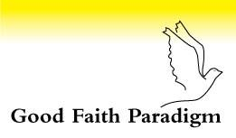
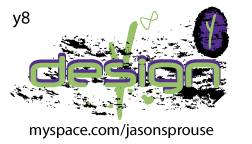
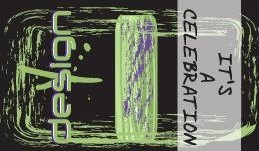

# The Digital Golden Plates & Harps of God Raffle Presentation Suite: Architectural Parameters, Delivered Multimodal Artifacts, and a Full-Stack Web3 Marketing Roadmap

**Principal Visionary & Author:** Jason Sprouse (*Good Faith Paradigm — "Let's Evolve to a Type I Civilization"*)  
**Systems Architecture & Agentic Engineering:** Antigravity AI  
**Date:** October 27, 2026  
**Live Production Portal:** [https://jasonsprouse.github.io/digital-golden-plates/](https://jasonsprouse.github.io/digital-golden-plates/)  
**Canonical Repository:** [https://github.com/jasonsprouse/digital-golden-plates](https://github.com/jasonsprouse/digital-golden-plates)  
**On-Chain Contract (`ERC-1155`):** `0xd07dc4262bcdbf85190c01c996b4c06a461d2430` ([Token `#492856` Yellow Y-Harps](https://rarible.com/token/0xd07dc4262bcdbf85190c01c996b4c06a461d2430:492856) • [Token `#490643` Green G-Harps](https://rarible.com/token/0xd07dc4262bcdbf85190c01c996b4c06a461d2430:490643))

---

## Abstract

This paper documents the design parameters, multimodal engineering deliverables, and future Web3 conversion architecture of the **Digital Golden Plates & NFT Harps of God Raffle Presentation Suite**, developed for the **Good Faith Paradigm (`GFP`)**. Beginning from primary video evidence ([`YWelJDhywu0`](https://www.youtube.com/watch?v=YWelJDhywu0)), December 2005 35mm photographic artifacts (*"The Miracles of The Holy Spirit"*), 3D spatial renders, and multidisciplinary research spanning quantum electrodynamics (QED), mammalian embryology, neuroplasticity, comparative mythology, and numismatic economics, the project was tasked with synthesizing and deploying a unified web-based presentation and e-commerce experience.

We first specify the exact **Engineering & Design Parameters Requested**, detailing the chronological evolution from raw archival assets to a dual-rail widescreen Web3 marketing portal with **Yellow `Y Harps of God (#492856)` on the Left Screen Rail**, **Green `G Harps-of-God (#490643)` on the Right Screen Rail**, interactive `aspect-[4/5]` high-resolution zoom inspection, and multi-model **Google TTS Natural MP3 Narration**. Second, we provide a complete **Technical Inventory of What Was Delivered** across the [`digital-golden-plates`](https://github.com/jasonsprouse/digital-golden-plates) repository and live GitHub Pages deployment. Finally, we present a **6-Phase Web3 Integration Roadmap** detailing how to evolve this presentation into a self-contained, cryptographically verifiable Web3 marketing funnel featuring embedded wallet & fiat checkout, slide-synchronized "Watch-to-Mint" proof-of-attention mechanics, **Chainlink VRF** provably fair drawings for the **2 oz Gold, 2 oz Silver, and 2 oz Copper Medallions**, and **Sign-In with Ethereum (`SIWE`)** token-gated VIP passes for the **Traveling Golden Plates Museum Tour**.

---

## 1. Parameters of What Was Requested

The project was defined by seven core functional, aesthetic, and cryptographic requirements established across iterative design sprints:

### 1.1 Exhaustive Synthesis of the Source Video & Archival Vault
1. **Primary Video Exegesis (`YWelJDhywu0`)**: Extract and index all **14 chronological examples** and demonstrations from Jason Sprouse's 12-minute 26-second *NFT Harps of God Raffle Presentation*—spanning the *Type I Civilization* call to action, the physical *2 oz Gold, 2 oz Silver, and 2 oz Copper Medallions*, the *2005 Aquarium Photographs*, the *9-Stage Cosmic Mnemonic*, the *`2,000,000 mph` Relativistic Flight Poem*, the *2000 & 2001 Music Festival Flyers*, the *Rorschach Sphinx & `$1` Unfinished Pyramid Calculation*, the *Solid-Gold & Gemstone Golden Plates*, the *`2000 → 2001` Card-Overlay Revelation*, and the *Traveling Museum Tour*.
2. **Good Faith Paradigm (`GFP`) Archival Integration**: Pair every video demonstration with its formal mathematical, biological, and theological counterpart from the GFP vault (*The Sacred Blueprint*, *The Physics of Theophany*, and *Prismatic Architecture: The Light Over The Word*), including:
   - **Photocentrism (`Lux > Logos`)**: Elevating direct quantum-optical observation above sectarian textual dogma.
   - **Pneumodynamics ($\Delta S_{\text{local}} = 0$)**: Modeling the Burning Bush and the 2005 aquarium reflections as sustained zero-local-entropy coherence states.
   - **Biological Genesis (`SRY` Spark)**: Mapping the Weeks 0–6 indifferent female embryonic baseline and the Week-7 `SRY` gene transcription factor to vessel-and-spirit cosmology.
   - **The Multiverse Proof Equation** etched onto Golden Plate I:
     $$\left(1^{\infty} = 1^{\infty}\right)^{\infty} \iff \left(\alpha^{\infty} = \omega^{\infty}\right)^{\infty}$$
   - **The 8-Domain Bayesian Convergence Proof**: Demonstrating a joint stochastic probability of $P = 2.50 \times 10^{-24}$ ($78.40\text{ bits}$ of specified Shannon information) and a Bayes Factor of $BF_{DC} = 3.96 \times 10^{23}$ in favor of intentional teleological design.

### 1.2 Three Distinct Multimodal Presentation Deliverables
The system was required to publish three complementary presentation formats from the conversation into a single cohesive web portal:
1. **NFT Harps of God Raffle Presentation — Good Faith Paradigm (16-Slide Deck)**: A dual-frame widescreen slide deck pairing high-resolution video evidence frames on the left with GFP scientific/theological diagrams on the right.
2. **Harps Inline Widget**: An interactive 3-tab laboratory allowing users to manipulate the **Golden Plate III (`2000 → 2001`) Card Overlay**, run the **3-Second `$1` Unfinished Pyramid & Sphinx Space-Time Counter (`1,666.7 miles` at `2,000,000 mph`)**, and explore the **9 Cosmic Analogies**.
3. **Prismatic Architecture: The Light Over The Word — Full-HD Video Presentation**: A `1920x1080` (`24fps`) rendered MP4 video (`Prismatic_Architecture_Presentation.mp4`, `10:11.8` runtime) synchronized with a 20-slide interactive carousel, timecode chapter jumper, and verbatim narration transcript.

### 1.3 Widescreen Dual-Rail NFT Marketing & Exact Token-to-Color Mapping
To transform the educational slide decks into a functional NFT acquisition and raffle-entry funnel, the layout was required to market the two Ethereum `ERC-1155` Digital Twin NFTs on the **Left and Right sides of the widescreen viewport** with strict adherence to token identity, card artwork, and column color coding:

| Screen Position & Column Color | NFT Title & Token ID | Front & Back Card Artwork | Direct Rarible Smart Contract Link |
| :---: | :--- | :---: | :---: |
| **⬅️ Left Screen Rail** 🟡 **YELLOW THEME (`amber-500`)** | **Y Harps of God** `Token ID #492856` *(Yellow `Good Faith Paradigm` Dove & 7 Faiths Card)* |   | **[💛 Buy Yellow Y-Harps (#492856) ↗](https://rarible.com/token/0xd07dc4262bcdbf85190c01c996b4c06a461d2430:492856)** |
| **➡️ Right Screen Rail** 🟢 **GREEN THEME (`emerald-500`)** | **G Harps-of-God** `Token ID #490643` *(Green `y8 design` / `IT'S A CELEBRATION` Card)* |   | **[🌿 Buy Green G-Harps (#490643) ↗](https://rarible.com/token/0xd07dc4262bcdbf85190c01c996b4c06a461d2430:490643)** |

### 1.4 High-Resolution `aspect-[4/5]` Card Framing & Interactive `🔍 Zoom` Lightbox
Both the Left and Right NFT rails and all presentation slide frames were required to preserve the signature `aspect-[4/5]` showcase frame with smooth `group-hover:scale-105` transitions, a frosted bottom status bar (`Front/Back` label + `🔍 Zoom` trigger), and a full-viewport `#lightbox-modal` (`Esc` or backdrop-click to dismiss).

### 1.5 Multi-Model Google TTS Voice Narration Engine
Rather than relying solely on robotic default operating-system speech synthesis, the presentation suite was required to integrate **Google Text-to-Speech (Google TTS)** neural voice models with both pre-rendered `.mp3` audio streams (`US Natural` and `UK Natural` voices) and live browser neural voice selection, complete with an embedded `<audio>` scrubber bar on every deck.

---

## 2. Technical Specification of What Was Delivered

All requested deliverables have been engineered, verified, and deployed to the `main` branch of [`jasonsprouse/digital-golden-plates`](https://github.com/jasonsprouse/digital-golden-plates) and published via GitHub Pages at **[https://jasonsprouse.github.io/digital-golden-plates/](https://jasonsprouse.github.io/digital-golden-plates/)**.

| Deliverable / Module | Repository File Path | Live Web URL | Technical Capabilities Delivered |
| :--- | :--- | :--- | :--- |
| **Master Unified Hub & Checkout Vault** | [`index.html`](../index.html) | [`.../index.html`](https://jasonsprouse.github.io/digital-golden-plates/) | Unified 4-tab portal hosting all 3 presentations, sticky **Left (Yellow `#492856`)** & **Right (Green `#490643`)** purchase rails, slide-synchronized relevance callouts, `🔍 Zoom` Lightbox modal, and the **Raffle & NFT Checkout Vault Modal**. |
| **1. NFT Harps of God Raffle Presentation (16-Slide Deck)** | [`nft_harps_presentation.html`](../nft_harps_presentation.html) [`docs/nft_harps_of_god_raffle_presentation.md`](./nft_harps_of_god_raffle_presentation.md) | [`.../nft_harps_presentation.html`](https://jasonsprouse.github.io/digital-golden-plates/nft_harps_presentation.html) | Standalone 16-slide dual-evidence presentation with Left Yellow (`#492856`) & Right Green (`#490643`) rails, `aspect-[4/5]` `🔍 Zoom` inspection, keyboard navigation (`←`/`→`), and Google TTS US/UK/Chrome neural narration. |
| **2. Harps Inline Widget (Interactive Simulators)** | [`harps_inline_widget.html`](../harps_inline_widget.html) | [`.../harps_inline_widget.html`](https://jasonsprouse.github.io/digital-golden-plates/harps_inline_widget.html) | Interactive 16-slide SVG schematic explorer, draggable **Golden Plate III (`2000 → 2001`) Card Overlay Simulator**, **3-Second `$1` Pyramid + Sphinx Space-Time Counter (`1,666.7 mi`)**, and **9-Stage Cosmic Mnemonic Explorer**. |
| **3. Prismatic Architecture: The Light Over The Word (1080p Video + 20-Slide Deck)** | [`prismatic_architecture.html`](../prismatic_architecture.html) [`Prismatic_Architecture_Presentation.mp4`](../Prismatic_Architecture_Presentation.mp4) | [`.../prismatic_architecture.html`](https://jasonsprouse.github.io/digital-golden-plates/prismatic_architecture.html) | Full-HD (`1920x1080`, `24fps`, `68.92 MB`, `10:11.8` runtime) MP4 video theater with 120 BPM harp/pad ambient score, interactive 20-slide carousel, timecode chapter table, and dual voice selector (**Google TTS Natural MP3** + **Studio `AvaNeural`**). |
| **4. Multi-Model Google TTS Audio Library (`72` Total MP3 Files)** | `audio_harps/slide_01..16.mp3` `audio_harps_uk/slide_01..16.mp3` `audio_prismatic_gtts/slide_01..20.mp3` `audio_prismatic/slide_01..20.mp3` | Served natively via GitHub Pages CDN | **52 Google Translate TTS Neural MP3 tracks** (16 Harps US, 16 Harps UK, 20 Prismatic US) + **20 Studio Edge-TTS `en-US-AvaNeural` MP3 tracks**, ensuring instant, zero-latency voice narration on all desktop and mobile browsers. |
| **5. Browser Database (`IndexedDB`) & PWA Service Worker Basket + Checkout Engine** | [`basket_pwa.js`](../basket_pwa.js) [`sw.js`](../sw.js) [`manifest.json`](../manifest.json) | Active across all 4 live pages | Persistent **`IndexedDB` (`GFP_Harps_Commerce_DB`)** shopping basket (`basket_items`), cryptographic **`SHA-256` Order Vault** (`checkout_orders`), **PWA Service Worker (`sw.js`)** with offline caching & Background Sync (`gfp-checkout-sync`), cross-tab `BroadcastChannel` sync, **W3C `PaymentRequest` API**, and **`EIP-191` (`personal_sign`) Web3 Wallet** checkout. |
| **6. High-Resolution Archival & 3D Visual Assets (`63` Image Files)** | [`assets/`](../assets) & [`slides_prismatic/`](../slides_prismatic) | Served natively via GitHub Pages CDN | 23 extracted video frames (`vid_01`–`vid_23`), 15 Sacred Blueprint slices (`slice_01`–`slice_15`), 5 PDF plates, 4 canonical NFT card faces, and 20 `1920x1080` Prismatic Architecture slides. |

---

## 3. Web3 Integration Roadmap: Building a Functional Web3 Marketing & Conversion Presentation

To transform the **Digital Golden Plates Presentation Suite** from an external-link showcase into a self-contained, full-stack **Web3 Marketing & Token-Gated Commerce Engine**, we define a **6-Phase Web3 Integration Roadmap**:

1. **Phase 1 (Implemented): Browser Database (`IndexedDB: GFP_Harps_Commerce_DB`) & PWA Service Worker (`sw.js`) Basket + Multi-Mode Checkout ([`basket_pwa.js`](../basket_pwa.js))**:
   - **Persistent Client-Side Database**: Stores selected NFTs (`token_492856_yellow`, `token_490643_green`, and the `bundle_revelation_pair` Complete Pair Bundle) in `IndexedDB` (`basket_items`), automatically calculating **Medallion Raffle Entries** (with a **+1 Synergy Bonus Entry** for holding both Yellow `#492856` and Green `#490643`) and **VIP Museum Tour Passes**.
   - **PWA Service Worker (`sw.js` & `manifest.json`)**: Pre-caches the presentation app shell and canonical NFT artwork, caches slides and Google TTS `.mp3` narrations for offline playback, synchronizes basket state across open tabs via `BroadcastChannel('gfp_basket_channel')`, and processes offline-queued orders via Background Sync (`gfp-checkout-sync`).
   - **3-Mode Checkout & Cryptographic Order Vault (`checkout_orders`)**: Supports **Web3 Wallet `EIP-191` (`personal_sign`) Receipts**, **W3C `PaymentRequest` API Express Checkout**, and **Direct Rarible Smart Contract Settlement**, generating a verifiable **`SHA-256` Receipt Hash** via the Web Crypto API and allowing collectors to download a portable `.json` **VIP Raffle & Museum Pass Receipt**.
2. **Phase 2: Slide-Synchronized "Watch-to-Mint" & Simulator Proof-of-Attention (`EIP-712` Vouchers)**:
   - Issue a cryptographic **Proof-of-Discovery** voucher when a viewer listens to the Google TTS narration, slides the Harp card across Golden Plate III (`2000 → 2001`), and completes the 3-second (`1,666.7-mile`) Sphinx count—granting a **2x Bonus Raffle Entry Multiplier** upon NFT purchase.
3. **Phase 3: Provably Fair On-Chain Medallion Raffle & Physical Escrow (`Chainlink VRF v2.5` + `Lit Protocol`)**:
   - Snapshot holders of `Token #492856` and `Token #490643` on contract `0xd07dc4262bcdbf85190c01c996b4c06a461d2430` and draw winners of the **2 oz Gold, 2 oz Silver, and 2 oz Copper Medallions** on-chain using **Chainlink VRF v2.5**, with encrypted shipping redemption.
4. **Phase 4: Token-Gated VIP Museum Tour Pass Generator (`EIP-4361 SIWE` + `Apple/Google Wallet` + `EAS`)**:
   - Allow NFT holders to sign a gasless Sign-In with Ethereum (`SIWE`) message in the presentation portal to generate a dynamic QR **Apple Wallet / Google Wallet VIP Pass** for the **Traveling Golden Plates Museum Tour**, recording attendance via an on-chain **Ethereum Attestation (`EAS`)** without burning the collector's NFT.
5. **Phase 5: Decentralized Permaweb Archival (`IPFS` + `Arweave` + `ENS goldenplates.eth`)**:
   - Pin all slides, 1080p video, and 72 neural audio files to **Arweave** and **IPFS**, resolving at `goldenplates.eth`.
6. **Phase 6: On-Chain Promoter Attribution (`?ref=0x...`), Sacred Treasury Progress Bar & WebXR ("The-Beach") Bridge**:
   - Enable automated referral splits honoring the 2000–2001 *"IT'S A CELEBRATION"* music festival promoter origins, track live funding milestones toward casting the solid-gold, emerald-, sapphire-, and diamond-inlaid **Golden Plates**, and bridge NFT holders into the **3D WebXR Oasis**.
