# NFT Harps of God Raffle Presentation — Good Faith Paradigm

> [!IMPORTANT]
> **Expanded Slide Show Presentation (`16 Slides`)** — Displaying every visual demonstration from the [NFT Harps of God Raffle Presentation (`YWelJDhywu0`)](https://www.youtube.com/watch?v=YWelJDhywu0) by **Jason Sprouse / Good Faith Paradigm**, enhanced with the full scientific, theological, biological, and economic canon of the **Good Faith Paradigm (GFP)**.

---

## Master Presentation Slide Deck (Slides 1–16)

Use the carousel controls below to step through all **16 slides** of the presentation, complete with extracted frames from the YouTube video alongside high-resolution archival blueprints from the Good Faith Paradigm corpus.

````carousel
### Slide 01 — Title & Mission: Evolving to a Type I Civilization
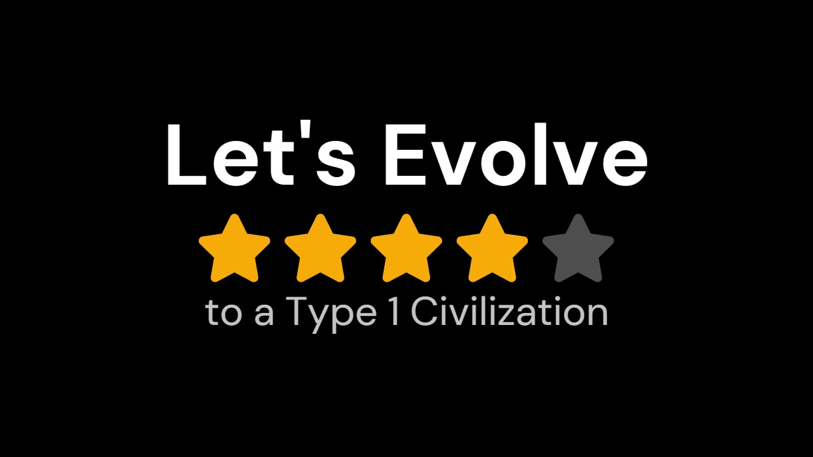

* **Video Opening (`00:00–00:10`)**: The presentation opens with the call *"Let's Evolve to a Type 1 Civilization"* (`4/5 stars`) before introducing **Jason Sprouse** on behalf of **Good Faith Paradigm**.
* **Good Faith Paradigm Enhancement — The Sacred Blueprint & Omega Point**:
  * In the broader GFP framework (*The Physics of Theophany* & *The Sacred Blueprint*), human civilization is advancing along **Pierre Teilhard de Chardin's** evolutionary trajectory from the inanimate **Geosphere** $\rightarrow$ biological **Biosphere** $\rightarrow$ globally networked **Noosphere**, converging toward **Frank Tipler's Omega Point** (infinite computational capacity and resurrection singularity).
  * Reaching a **Type I Kardashev / Fifth Sun Civilization** requires uniting ancient spiritual revelation (**The Word**) with objective physical observation (**The Light**):
    $$\text{The Light (Photocentrism / QED)} > \text{The Word (Logocentrism / Dogma)}$$
<!-- slide -->
### Slide 02 — The 2 oz Gold, Silver & Copper Medallion Raffle
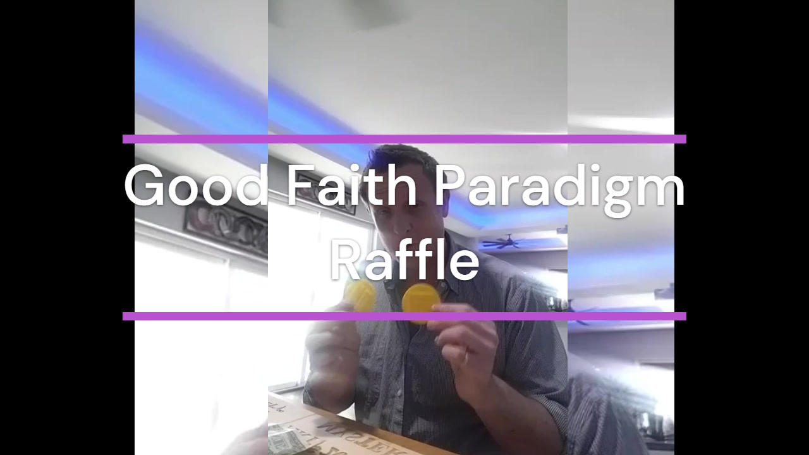

* **Video Demonstration (`00:12–00:35`)**: Jason displays the physical raffle medallions encased in protective yellow cases — struck in **two ounces of fine Gold**, **two ounces of fine Silver**, and **two ounces of pure Copper**.
* **Good Faith Paradigm Enhancement — The Economic Ark & Secure Collateral**:
  * Why precious metal medallions? In *The Miracles of the Holy Spirit* (Section I: *The Archetype of the Deluge*), GFP compares the Biblical Noah account (which preserves *biological life only*) with the older Sumerian/Babylonian accounts in the **Epic of Gilgamesh (Tablet XI)** and **Atrahasis**, where **Utnapishtim** is commanded by Ea/Enki:
    > *"Whatever I had of silver I laded upon her; Whatever I had of gold I laded upon her; Whatever I had of all the living being I laded upon her... and all the craftsmen."*
  * The **Gold, Silver, and Copper Medallions** embody **Utnapishtim's Secure Collateral**—preserving movable, incorruptible value alongside biological life and *techne* (engineering skill) to anchor the **Economic Ark**.
<!-- slide -->
### Slide 03 — Medallion Die Blueprint: "The Miracles of The Holy Spirit"
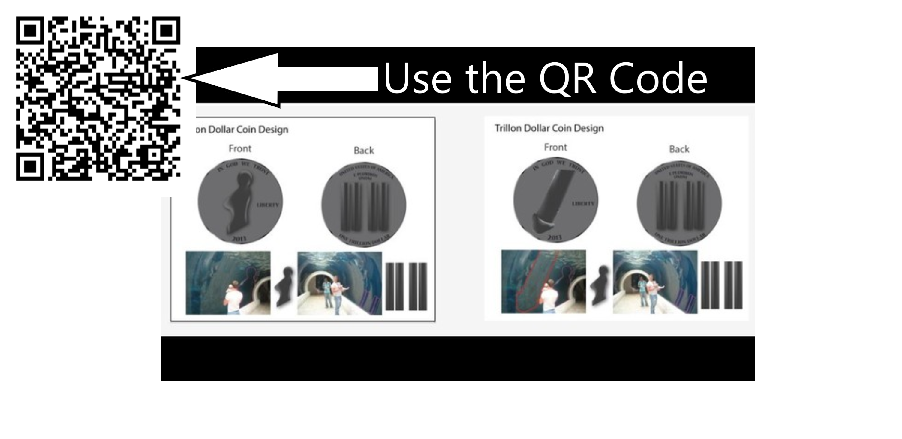

* **Video Demonstration (`00:26–01:18`)**: The medallions feature dual **Masculine and Feminine** reliefs derived directly from two 2005 photographs titled ***"The Miracles of The Holy Spirit"***.
* **Good Faith Paradigm Enhancement — The Tripartite Pledge & Relic of Providence**:
  * **Obverse (Front)**: *"IN GOD WE TRUST"*, *"LIBERTY"*, *"2013"* — struck in two complementary variants:
    1. **Feminine Relief (Left Coin)**: The womb/maternal silhouette from the aquarium glass reflection (Moon / Silver / Receptive Base / Isis).
    2. **Masculine Relief (Right Coin)**: The phallic column / Burning Bush pillar of light from the aquarium tank reflection (Sun / Gold / Active Catalyst / Osiris).
  * **Reverse (Back)**: *"UNITED STATES OF AMERICA"*, *"E PLURIBUS UNOM"*, *"ONE TRILLION DOLLAR"*, featuring the four vertical pillars (`11 11` / Twin Towers architectural reflection).
  * Links directly to the closing pledge of the U.S. Declaration of Independence: **Our Lives** (Biological Ark / Noah), **Our Fortunes** (Economic Ark / Utnapishtim's Gold & Silver), and **Our Sacred Honor** (Covenantal Oath / Atrahasis).
<!-- slide -->
### Slide 04 — Phenomenological Prompt: The 2005 Aquarium Reflections
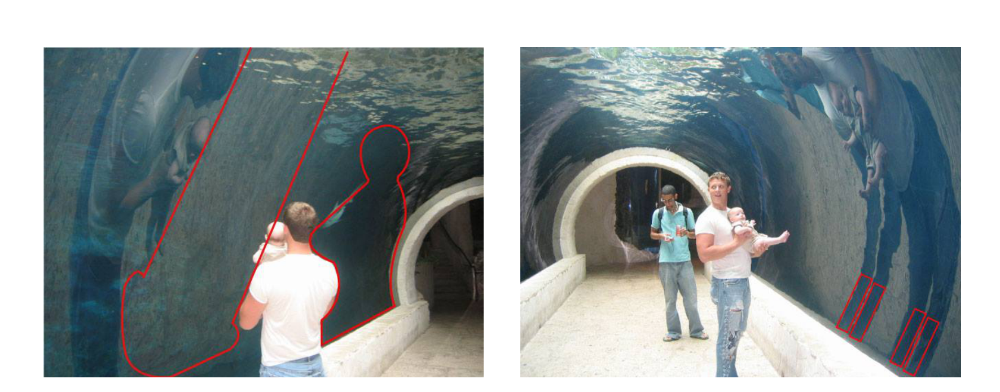

* **Video Demonstration (`00:36–01:17`)**: Jason holds up the printed sheet of *"The Miracles of The Holy Spirit"* (`01:18`), explaining how the images unite biological evolution, scientific physics, and comparative world religion.
* **Good Faith Paradigm Enhancement — Quantum Pneumatology & Osirian Reconstruction**:
  * **Quantum Electrodynamics (QED) & The Observer Effect**: Under QED, photons mediate all electromagnetic interactions. Rather than a photographic accident, the 2005 aquarium reflection is analyzed as a **Quantum Event** where the camera lens acted as the detector in a **Double-Slit Experiment**, collapsing the quantum probability wave (*the Sea of Glass*) into a localized particle manifestation (**Theophany**).
  * **Zero Local Entropy ($\Delta S_{\text{local}} = 0$)**: Like Moses's **Burning Bush** (Exodus 3:2) that burns with fire without being consumed, the photon exchange exhibits sustained spiritual coherence without thermal degradation.
  * **Comparative Mythology**: Mirrors the Egyptian resurrection cycle of **Osiris and Isis** (where Isis reconstructs the shattered 14 pieces of Osiris using the **Golden Phallus** to conceive **Horus**), the **Hindu Trimurti** (*Brahma, Vishnu, Shiva*), the **Wiccan Triple Goddess** (*Maiden, Mother, Crone*), and the **11:11 Midwayer Synchronicity Signal** (the four vertical columns echoing the 1,111 loyal secondary Midwayers of *The Urantia Book*).
<!-- slide -->
### Slide 05 — Biological Analogies: Fetal Development & The SRY Catalyst
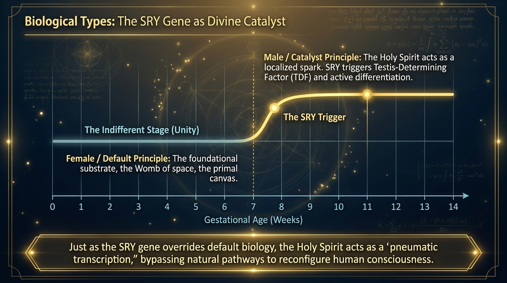

* **Video Demonstration (`00:35–01:10`)**: Jason explains the biological analogy encoded in the Masculine and Feminine medallions:
  > *"In the womb through the fetus cycle, the embryo develops first with female origins, and as testosterone or estrogen takes its pace, it fulfills the developmental blueprint of those hormones."*
* **Good Faith Paradigm Enhancement — Indifferent Stage Unity to Week-7 Transcription**:
  * **Weeks 0–6 (The Indifferent / Bipotential Stage)**: All mammalian embryos ($XX$ and $XY$) begin in a state of foundational unity along the female baseline (*The Divine Feminine / Mater / The Womb of Space*).
  * **Week 7 (The SRY Catalyst)**: Located on the $Y$ chromosome, the **SRY gene** (*Sex-determining Region Y*) fires to produce the **Testis-Determining Factor (TDF)**, triggering **Testosterone** (masculinizing external structures) and **Anti-Müllerian Hormone (AMH)**.
  * **Pneumatological Parallel**: Just as the SRY gene acts as a localized genetic spark that differentiates the indifferent gonad, the **Holy Spirit (*Pneuma*)** acts as the divine transcription catalyst that transforms the natural mind (*Psychikos*, localized high-entropy particle state) into a child of the Spirit (*Pneumatikos*, non-local coherent wave state).
<!-- slide -->
### Slide 06 — The Harps of God: Digital Twin NFTs (`G-Harps` & `Y-Harps`)
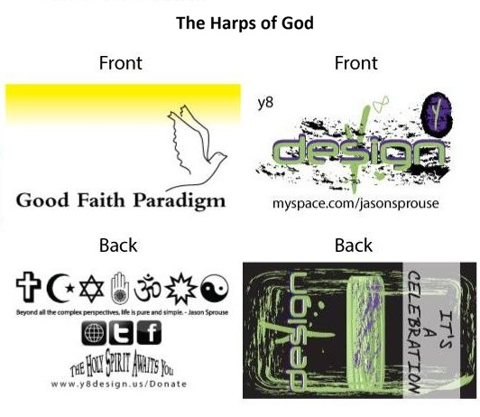

* **Video Demonstration (`01:18–01:42`)**: Jason introduces the two **Harps of God** art cards (now minted as Digital Twin NFTs on Rarible for the medallion raffle) and cites **Revelation 15:2**:
  > *"And I saw as it were a sea of glass mingled with fire: and them that had gotten the victory over the beast, and over his image, and over his mark, and over the number of his name, stand on the sea of glass, having the harps of God."* ( Also linked with **Psalm 84:11** & **Isaiah 60:19–20**).
* **Good Faith Paradigm Enhancement — On-Chain Provenance & Syncretic Iconography**:
  * **Y Harps of God (Yellow — Rarible Token ID `0xd07dc426...492856`)**: The **Yellow** card featuring the ascending Dove of the Holy Spirit illuminated by the uncreated Yellow/Golden Light on the front, and **7 unified world religion symbols** (Christianity, Islam, Judaism, Jainism, Hinduism, Bahá'í, Taoism) on the back with the maxim: *"Beyond all the complex perspectives, life is pure and simple. — Jason Sprouse"*.
  * **G Harps-of-God (Green — Rarible Token ID `0xd07dc426...490643`)**: The **Green** card featuring the `y8 design` emblem with the purple `Y` singularity, infinity loop ($\infty$), grunge inkblot field, and *"IT'S A CELEBRATION"* cosmic harp strings on the reverse.
<!-- slide -->
### Slide 07 — The Cosmic Mnemonic: 9 Scientific Analogies of the Universe
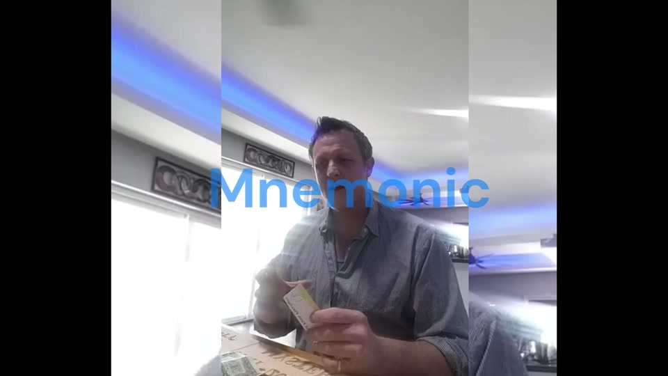

* **Video Demonstration (`01:42–02:22` & `07:32–07:58`)**: With the on-screen title **`Mnemonic`**, Jason explains that the *Harps of God* function as a **mind memorization device (mnemonic)** mapping the chronological evolution and physical structures of the cosmos—combining intentional universal design with serendipitous visual discoveries.
* **Good Faith Paradigm Enhancement — The Complete 9-Stage Cosmological Sequence**:
  1. **Time Zero (The Beginning of the Universe)**: The initial hot, dense Big Bang boundary—the first plucking of the cosmic harp.
  2. **The Cosmic Dark Ages**: The silent cooling epoch where neutral hydrogen, helium, and lithium filled the vacuum before stellar ignition.
  3. **Birth of the First Stars**: Primordial gas vortexes aggregating into nuclear fusion—the cosmological analogue of *"Let there be light"* (Genesis 1:3).
  4. **Supermassive Black Hole**: The unseen gravitational center (`Y` purple vortex) shaping and rotating surrounding stars and planetary masses.
  5. **The Galactic Arm (Milky Way)**: The luminous band of interstellar dust remnants and gas filaments—the Biblical *"Sea of Glass mingled with fire"*.
  6. **Quasar (Cosmic Beacon)**: A supermassive black hole siphoning gas from a star near its event horizon, shining brighter than hundreds of galaxies.
  7. **Aurora Borealis (Local Cosmic Light)**: Solar wind particles funneled by Earth's magnetic field into glowing polar curtains.
  8. **Dark Matter (Invisible Structure)**: The unseen ~85% of cosmic matter serving as the silent structural frame of the cosmic harp.
  9. **The Graviton (Hypothetical Force Carrier)**: The massless quantum boson mediating gravity at the speed of light.
<!-- slide -->
### Slide 08 — Visual Example 1 & 2: Aurora Borealis & Our 2,000,000 MPH Flight
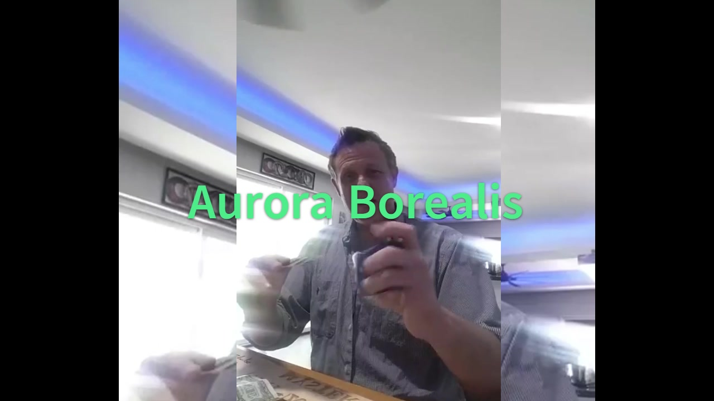

* **Video Demonstration (`02:23–03:15` & `05:38–06:20`)**:
  * **Aurora Borealis (`02:28`)**: Jason places the `Y-Harps` card directly above an Earth-like globe, showing how the green and purple arched strokes crown the planet's pole like the **Aurora Borealis**.
  * **Relativistic Motion Through Space-Time (`02:48` & `05:45`)**: When holding the card stationary in your hand, you are actually hurtling through the universe with our galaxy at **~2,000,000 mph**:
    * Sitting stationary: $\approx 2,000,000\text{ mph}$
    * Driving a car: $\approx 2,000,040\text{ mph}$
    * Flying in a commercial jet: $\approx 2,000,600\text{ mph}$
    * Orbiting in the International Space Station (ISS): $\approx 2,017,500\text{ mph}$
* **Original Inspiring Poem Recited in the Video (`03:02–03:12`)**:
  > *"No sea or sky, just a mind in flight,*
  > *On a ride through the universe,*
  > *Despite the fact you can't see the Ultimate Reality."*
<!-- slide -->
### Slide 09 — Visual Example 3, 4 & 5: Early Universe, First Star & Graviton
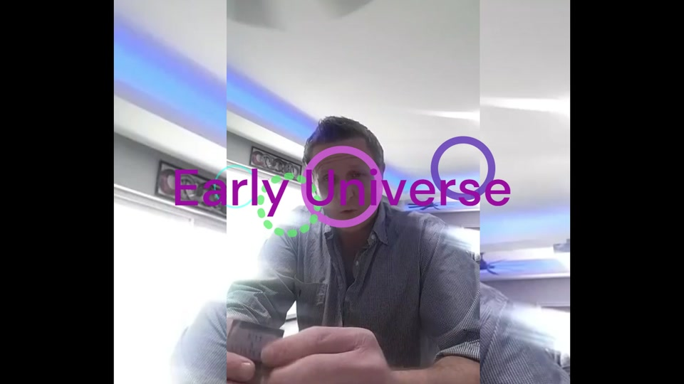

* **Video Demonstration (`04:00–04:55`)**:
  * **Early Universe Overlay (`04:00`)**: Purple and green target rings highlight specific regions of the `Y-Harps` card corresponding to the post-Big Bang cooling phase.
  * **Primordial Gas Vortexes & Stellar Ignition**: As hydrogen, helium, and lithium expanded through the vacuum, swirling vortexes accumulated mass until gravitational pressure triggered nuclear fusion—igniting the **First Star**.
  * **The Graviton (`04:45`)**: Jason points out the discrete circular dot next to the vertical stem on the card, representing the **Graviton**—the theoretical elementary particle mediating the force of gravity across the cosmos.
* **Good Faith Paradigm Enhancement — The Higgs Field & Quantum Vacuum**:
  * In *The Physics of Theophany* (Section 2.5), GFP pairs the **Graviton** and **Photon** with the **Higgs Field ("The God Particle")**: just as massless fundamental particles acquire physical mass by interacting with the universe-spanning Higgs field, massless divine intent acquires localized, observable reality through the **Holy Spirit**.
<!-- slide -->
### Slide 10 — Visual Example 6 & 7: Supermassive Black Holes, 3 Earths & Quasars
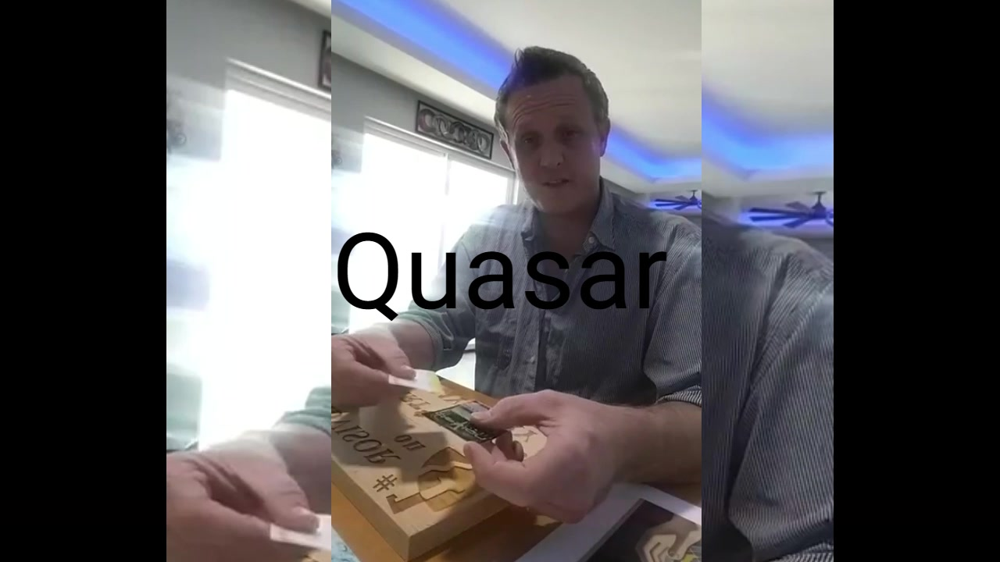

* **Video Demonstration (`04:58–05:38` & `06:22–06:45`)**:
  * **Three Earths & The Supermassive Black Hole (`05:00–05:30`)**: Using the tabletop diagram showing three Earth representations, Jason places the dark purple/black oval of the `Y-Harps` card at the center to illustrate a **Supermassive Black Hole** (as well as **rogue black holes** traversing deep space) holding stars and planetary systems in its gravitational vortex.
  * **Quasar Overlay (`06:32`)**: Placing the card beside a star/sun near the black hole's **Event Horizon**, Jason demonstrates how the black hole siphons gas from the companion star—igniting a **Quasar**, the brightest electromagnetic beacon visible across billions of light-years.
* **Good Faith Paradigm Enhancement — `ER = EPR` & Holographic Horizon**:
  * Links to the **Holographic Principle** (cited in *The Harps of God* PDF) where 3D universal information is encoded on the 2D boundary surface of the event horizon, and **Black-Hole Quantum Teleportation (`ER = EPR`)** bridging non-local consciousness.
<!-- slide -->
### Slide 11 — Visual Example 8: The Galactic Arm & The "Sea of Glass"
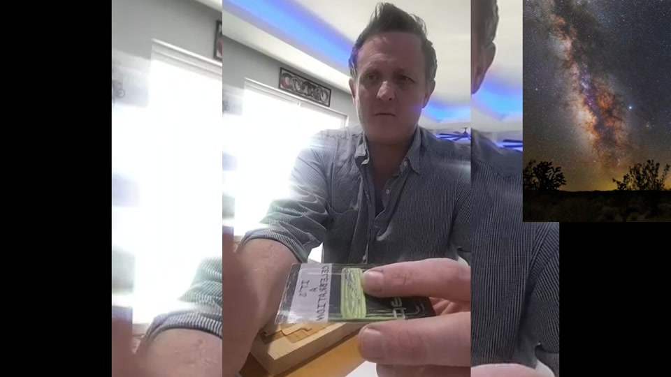

* **Video Demonstration (`06:48–07:30`)**:
  * With a real astronomical photograph of the **Milky Way Galactic Plane** displayed in the top-right corner (`07:02`), Jason holds the `Y-Harps` card horizontally to show how its green/purple luminous band and dark dust streaks mirror the leftover dust and gas remnants of our **Galactic Arm**.
* **Good Faith Paradigm Enhancement — Cosmological Exegesis of Revelation 15:2**:
  * In *The Miracles of the Holy Spirit* (Section IX: *Cosmological Exegesis: The Galactic Harp*), the **"Sea of Glass mingled with fire"** (Revelation 15:2) is decoded as an observational astronomy map of the **Milky Way Galactic Plane** illuminated by the dense star fields and nebulae of the galactic core.
  * The **"Harps of God"** are the dark interstellar dust lanes and filaments threading through the spiral arms—vibrating with star-formation energy and gravitational waves, which NASA sonification projects literally translate into pitch as a cosmic harp.
<!-- slide -->
### Slide 12 — Visual Example 9: Music Festival Origins (2000 & 2001 Flyers)
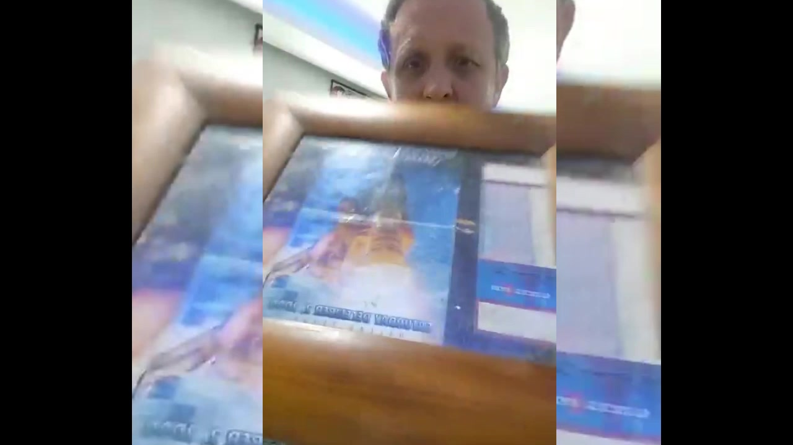

* **Video Demonstration (`03:18–03:55` & `08:01–08:25`)**:
  * Jason explains that as a longtime music and event promoter, he originally designed the *Harps of God* card as a physical-to-digital art piece whose sales proceeds would fund a **free Music Festival** for attendees (`"IT'S A CELEBRATION"`).
  * At `08:15–08:20`, he displays the framed original artwork and flyers from his **2000 and 2001 music events** (featuring the floating island in the clouds).
* **Good Faith Paradigm Enhancement — The Year 2000 Awakening & Musical Canon**:
  * The **2000–2001 epoch** marks the foundational origin point of the Good Faith Paradigm timeline:
    * **2000**: Jason Sprouse's transformative Near-Death Experience (NDE) & Spiritual Awakening + first Music Festival promotion.
    * **2005**: Capture of *"The Miracles of The Holy Spirit"* aquarium theophany photographs.
    * **2012/2013**: Mayan 13th Baktun transition into the **Fifth Sun ("Job Ajaw" / Cycle of Light)** and the *8 Newfound Revelations*.
    * **2021–2026**: Original music productions (*Religion* on `V1.5.0 EP`, *A Miracle at the Helm*, *Breaking the Frame*, *OceanBreeze*, *Heaven*, *Hot*) and Web3 XR integration (*The-Beach XR*).
<!-- slide -->
### Slide 13 — Visual Example 10 & 11: Rorschach Sphinx & The \$1 Bill Pyramid
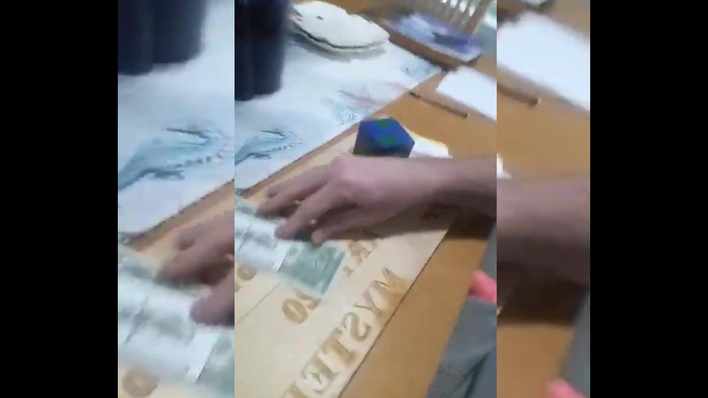

* **Video Demonstration (`08:35–09:55`)**:
  * **Rorschach Inkblot Interpretation (`08:45–09:12`)**: With the overlay **`ink blot test / rorschach`**, Jason shows how the black grunge splatter on the front of the `Y-Harps` card acts as a projective Rorschach test—revealing the **body of a rising Phoenix** at the base and the **head of the Great Sphinx**.
  * **Completing the Unfinished Pyramid on the U.S. \$1 Bill (`09:13–09:55`)**: Holding up the reverse of a U.S. \$1 bill (*"IN GOD WE TRUST"* and the Great Seal's **Unfinished Pyramid**), Jason places the card's **Sphinx head** directly atop the Unfinished Pyramid as its capstone (`09:35`).
  * **Space-Time Distance Calculation**: Counting *"one-one-thousand, two-one-thousand, three-one-thousand"* ($t = 3\text{ seconds}$) while the Sphinx crowns the pyramid, we can calculate the exact distance the physical Sphinx in Giza has traveled through space-time at $v \approx 2,000,000\text{ mph}$:
    $$d = v \times t = \frac{2,000,000\text{ miles}}{3,600\text{ sec}} \times 3\text{ sec} \approx 1,666.67\text{ miles per 3-second count}$$
<!-- slide -->
### Slide 14 — Visual Example 12: The Three Golden Plates & Multiverse Proof
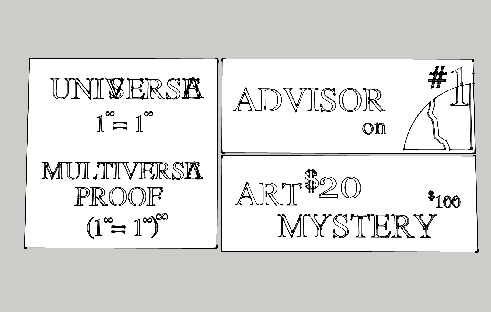

* **Video Demonstration (`10:00–10:42`)**: Jason introduces the **Golden Plates** carved in wood on the presentation table, explaining that proceeds from the *Harps of God* NFT raffle will fund **molding the Golden Plates in solid gold inlaid with emeralds, sapphires, and diamonds**, and crafting the **Harps of God in Onyx and Emerald**.
* **Good Faith Paradigm Enhancement — Decoding the Three Golden Plates**:
  1. **Plate I (Left — The Universe & Multiverse Proof)**:
     $$\underbrace{\left(1^\infty = 1^\infty\right)}_{\text{Single Universe: Big Bang }\leftrightarrow\text{ Big Rip}} \quad \Longrightarrow \quad \underbrace{\left(1^\infty = 1^\infty\right)^\infty}_{\text{Multi-Verse}} \iff \underbrace{\left(\alpha^\infty = \omega^\infty\right)^\infty}_{\text{Alpha–Omega Eternal Cycle}}$$
     Where the left boundary ($1^\infty$ / $\alpha^\infty$) is the **Big Bang Singularity (Time Zero)** and the right boundary ($1^\infty$ / $\omega^\infty$) is the **Big Rip Terminal Singularity**, recycling kinetic energy across infinite universes.Notice also `UNIVERSE` with `V` and `A` superimposed (`UNIVERSE` / `UNA VERSE` — *"One Song"*).
  2. **Plate II (Top Right — `ADVISOR on #1`)**: Depicts the fractured dome/horizon leading to `#1`—bridging the 3D SketchUp Earth/Solar System alignment (`plates_08.jpg`) and divine counsel.
  3. **Plate III (Bottom Right — `ART $20 MYSTERY $100`)**: The interactive numerical matrix designed to receive the *Harps of God* cards and U.S. currency.
<!-- slide -->
### Slide 15 — Visual Example 13: The `2000` $\rightarrow$ `2001` Golden Plate Synergy
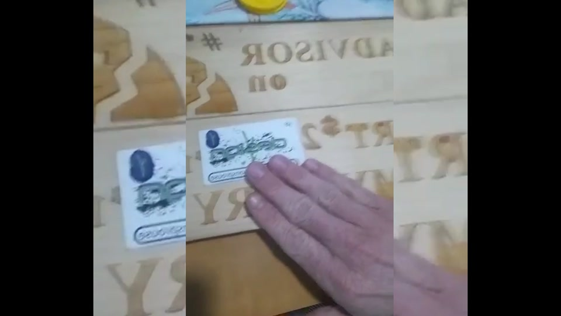

* **Video Demonstration (`10:43–11:38`)**:
  * On the third Golden Plate (`ART $20 MYSTERY $100`), the `20` from `\$20` and the `00` from `\$100` visually combine across the plate to form **`2000`** (the year of the first music festival and Jason's spiritual awakening).
  * When Jason slides the **Harps of God** card across the plate (`11:02`) to cover the `0` in `100`, it isolates and reveals the **`1`**—transforming **`2000`** into **`2001`** (the year of the second music festival and the `9/11` Twin Towers event echoed in the `11:11` aquarium reflection).
  * As Jason notes in the video (`11:19`): *"Much of this stuff wasn't planned—it wasn't a conscious design to tie into these types of things; it's just something that happened serendipitously, fortuitously."*
* **Good Faith Paradigm Enhancement — Bayesian Calculus of Convergence**:
  * In *The Sacred Blueprint* (Slice 04), evaluating the independent convergence of these religious, mathematical, biological, and synchronistic motifs yields a joint stochastic probability of $P = 2.50 \times 10^{-24}$ ($78.40\text{ bits}$ of Shannon information, **Bayes Factor $3.96 \times 10^{23}$**)—mathematically refuting random coincidence in favor of **Pneumatic Design**.
<!-- slide -->
### Slide 16 — Visual Example 14: Solid-Gold Museum Tour &The 8 Newfound Revelations
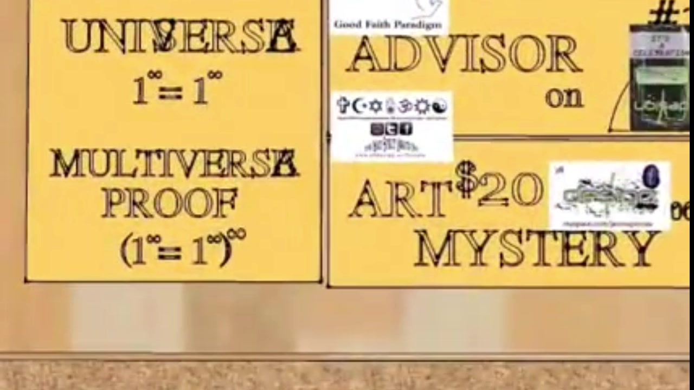

* **Video Finale (`11:40–12:26`)**:
  * Once the **Golden Plates** are cast in **solid gold and inlaid with emeralds, sapphires, and diamonds** (and the **Harps of God** crafted in **onyx and emerald**), Good Faith Paradigm plans to launch a **traveling Museum Tour**.
  * Every **Harps of God Digital Twin NFT** acquired in the raffle for the **2 oz Gold, 2 oz Silver, and 2 oz Copper Medallions** is designed to serve as a **one-time VIP Museum Tour admission pass** per person!
* **Good Faith Paradigm Enhancement — The 8 Newfound Revelations & 2 Directives**:
  1. *God is the principal designer of all matter known and unknown.*
  2. *God's creations flourish under the umbrella of probability, not chance.*
  3. *God's creations exist in a constant state of change.*
  4. *There is no good or bad, only wise and unwise.*
  5. *Free will allows us to move closer or further from God with each and every thought.*
  6. *We are not human beings having a spiritual experience; we are spiritual beings having a human experience.*
  7. *The body is our temple.*
  8. *Respect for our environment is critical for the longevity of our gift of life.*
  * **Directives**: *(I) Devotion to unity is the only path to the inner circle of Christ consciousness.* *(II) Tithe to reflect your spiritual symmetry.*
````

---

## Architectural Synthesis: How the Video's Examples Connect Across the Good Faith Paradigm

```mermaid
flowchart TD
    subgraph RAFFLE["1. Physical & Digital Raffle Assets"]
        M_GOLD["2 oz Gold Medallion<br/>(Masculine / Sun / Osiris Catalyst)"]
        M_SILV["2 oz Silver Medallion<br/>(Feminine / Moon / Isis Base)"]
        M_COPP["2 oz Copper Medallion<br/>(Conductive Earth / Aurora)"]
        NFT_G["Green G Harps-of-God NFT<br/>(Rarible #490643 — Green y8 Design & Harp)"]
        NFT_Y["Yellow Y Harps of God NFT<br/>(Rarible #492856 — Yellow Dove & 7 Faiths)"]
    end

    subgraph MIRACLES["2. 'The Miracles of The Holy Spirit' (2005 Photos)"]
        QED["Quantum Electrodynamics (QED)<br/>'The Light > The Word'"]
        SLIT["Double-Slit Observer Collapse<br/>& Zero Entropy (ΔS_local = 0)"]
        SRY["Biological Analogy: Week 0–6 Female Base<br/>→ Week 7 SRY Gene Catalyst"]
        SYNC["11:11 Midwayer Entanglement<br/>& Triadic Religious Symmetry"]
    end

    subgraph MNEMONIC["3. Cosmic Mnemonic on the Harps of God"]
        C1["Time Zero (Big Bang) & Dark Ages"]
        C2["Gas Vortexes → First Star Ignition"]
        C3["Graviton, Dark Matter & Black Holes"]
        C4["Quasar Beacon & Aurora Borealis"]
        C5["Galactic Arm = 'Sea of Glass' (Rev 15:2)"]
        C6["2,000,000 MPH Galactic Motion"]
    end

    subgraph PLATES["4. Golden Plates, Currency Synergies & Museum Tour"]
        RORSCH["Rorschach Inkblot: Phoenix & Sphinx<br/>Crowning the $1 Bill Unfinished Pyramid"]
        PLATE_EQ["Golden Plate I: Multiverse Proof<br/>(1^∞ = 1^∞)^∞ ⇔ (α^∞ = ω^∞)^∞"]
        PLATE_YR["Golden Plate III: ART $20 MYSTERY $100<br/>Harps Overlay: 2000 → 2001 Synergy"]
        TOUR["Solid Gold + Emerald/Sapphire/Diamond Plates<br/>& Onyx/Emerald Harps → Museum Tour Pass"]
    end

    RAFFLE --> MIRACLES
    MIRACLES --> MNEMONIC
    MNEMONIC --> PLATES
```

---

## Complete Timestamped Matrix of Examples Shown in the Video vs. GFP Enhancements

| Video Timestamp | Visual Example Demonstrated in Video (`YWelJDhywu0`) | Good Faith Paradigm (GFP) Expanded Knowledge & Theoretical Enhancement |
| :--- | :--- | :--- |
| **`00:00–00:10`** | **"Let's Evolve to a Type 1 Civilization"** title card & introduction by Jason Sprouse. | Connects to **Teilhard de Chardin's Noosphere**, **Frank Tipler's Omega Point**, and the transition from the 4th Cycle to the **Mayan Fifth Sun (*Job Ajaw*)**. |
| **`00:12–00:35`** | **2 oz Gold, 2 oz Silver & 2 oz Copper Medallions** held up in protective cases. | Grounded in **Utnapishtim's Economic Ark** (*Epic of Gilgamesh* Tablet XI & *Atrahasis*), preserving Gold & Silver ("Secure Collateral") alongside biological life and *techne*. |
| **`00:35–01:17`** | **Masculine & Feminine Duality** on the medallions & embryonic development in the womb. | Detailed in *The Physics of Theophany* §3.1: **Weeks 0–6 Indifferent/Female Baseline** (*Mater*) differentiated at **Week 7 by the SRY Gene (TDF / Testosterone)** as a biological type of the Holy Spirit (*Pneuma*). |
| **`01:18–01:42`** | ***"The Miracles of The Holy Spirit"*** printout & **Revelation 15:2** (*Sea of Glass & Harps of God*). | Grounded in **Photocentrism (*The Light > The Word*)**, **Double-Slit Wave Function Collapse**, **Zero Local Entropy ($\Delta S_{\text{local}} = 0$)** in the Burning Bush, and **Osirian Golden Phallus** reconstruction. |
| **`01:43–02:22`** | **`Mnemonic` Overlay**: Using the *Harps of God* cards as a memory device for cosmic structures. | Codified into the **9-Stage Cosmological Sequence** (*Time Zero, Cosmic Dark Ages, First Stars, Supermassive Black Hole, Galactic Arm, Quasar, Aurora Borealis, Dark Matter, Graviton*). |
| **`02:23–02:40`** | **`Aurora Borealis` Overlay**: Holding the `Y-Harps` card over an Earth globe's polar region. | Interprets the aurora as a local planetary expression of **Quantum Electrodynamics (QED)** where Earth's liquid-core magnetosphere channels solar wind photons into visible light. |
| **`02:42–03:15`** & **`05:38–06:20`** | **2,000,000 MPH Cosmic Velocity** (Car $+40\text{ mph}$, Plane $+600\text{ mph}$, ISS $+17,500\text{ mph}$) & *"Mind in Flight"* poem. | Demonstrates relativistic reference frames: even when stationary in the localized *Psychikos* particle state, the observer is hurtling through the macrocosmic temple at $2 \times 10^6\text{ mph}$. |
| **`03:18–03:55`** & **`08:01–08:25`** | **Music Festival Origin (`"IT'S A CELEBRATION"`)** & framed **2000 / 2001 Event Flyers**. | Bridges Jason Sprouse's 2000 Near-Death Experience (NDE) and festival promotion with the physical-to-digital twin synergy of Rarible NFTs (`#490643` & `#492856`). |
| **`04:00–04:55`** | **`Early Universe` Overlay**: Hydrogen/Helium/Lithium gas vortexes, **Birth of the First Star**, and the **Graviton**. | Pairs stellar ignition with Genesis 1:3 (*"Let there be light"*) and integrates the **Graviton** and **Higgs Field ("The God Particle")** as the physical mechanics of manifestation. |
| **`04:58–05:38`** & **`06:22–06:45`** | **Supermassive Black Hole** suspending **3 Earths**, rogue black holes, and **`Quasar` Overlay**. | Links the black hole event horizon to the **Holographic Principle** (3D reality projected from a 2D boundary) and active galactic nuclei (Quasars) as sustained cosmic notes. |
| **`06:48–07:30`** | **Milky Way Galactic Arm Overlay** compared side-by-side with the horizontal `Y-Harps` card. | Decodes the Biblical **"Sea of Glass mingled with fire"** (Rev 15:2) as the Milky Way Galactic Plane, and the **"Harps of God"** as vibrating interstellar dust filaments (NASA sonification). |
| **`08:35–09:55`** | **`ink blot test / rorschach` Overlay** (Phoenix body & Sphinx head) + **Sphinx crowning the \$1 Bill Unfinished Pyramid** (`1-1000, 2-1000, 3-1000`). | Applies projective cognitive architecture (*Psychikos* $\rightarrow$ *Pneumatikos*) and calculates the Sphinx's space-time displacement ($\approx 1,666.7\text{ miles}$ every 3 seconds at $2,000,000\text{ mph}$). |
| **`10:00–11:38`** | **Carved Golden Plates**, solid gold + emerald/sapphire/diamond inlay plan, and **`2000` $\rightarrow$ `2001` Card Overlay** on `ART $20 MYSTERY $100`. | Explicates the **Multiverse Proof Equation** $\left(1^\infty = 1^\infty\right)^\infty \iff \left(\alpha^\infty = \omega^\infty\right)^\infty$ and the **Bayesian Calculus of Convergence** ($\text{Bayes Factor } 3.96 \times 10^{23}$). |
| **`11:40–12:26`** | **Museum Tour Vision**: Raffle NFTs granting one-time admission to see the solid-gold, gem-inlaid Golden Plates & Onyx/Emerald Harps. | Culminates in the **Axolotl Metanoia** (collapsing the glass between observer and reflection) and the **8 Newfound Revelations & 2 Directives** of the Fifth Sun. |
