# Prismatic Architecture: The Light Over The Word — Full-HD Video Presentation

> [!IMPORTANT]
> **Master Video Specification (`Prismatic_Architecture_Presentation.mp4`)**
> - **Source Deck**: [Prismatic_Architecture.pdf](file:///C:/Users/jason/Downloads/Prismatic_Architecture.pdf) (`https://notebooklm.link.google/4kBUEm84vfqc`)
> - **Resolution & Frame Rate**: `1920x1080` Full HD (16:9 Widescreen) @ `24 fps` (`H.264 High Profile`, `yuv420p`)
> - **Audio Master**: Studio Neural Voiceover (`en-US-AvaNeural`) mixed with a 120 BPM Sacred-Harmonic Celestial Harp & Melodic Pad soundtrack (`44.1 kHz Stereo AAC`, `256 kbps`)
> - **Total Runtime**: `10:11.79` (`611.8 seconds` across all 20 slides, with smooth `0.35s` optical fade transitions and a bottom gold progress bar)
> - **Saved Locations**:
>   - **Downloads**: [Prismatic_Architecture_Presentation.mp4](file:///C:/Users/jason/Downloads/Prismatic_Architecture_Presentation.mp4) (`68.92 MB`)
>   - **Project Workspace**: [Prismatic_Architecture_Presentation.mp4](file:///C:/Users/jason/.gemini/antigravity/scratch/harps-of-god-raffle-presentation/Prismatic_Architecture_Presentation.mp4)
>   - **Artifact Directory**: [Prismatic_Architecture_Presentation.mp4](file://../Prismatic_Architecture_Presentation.mp4)

---

## 1. Embedded Full-HD Video Player


---

## 2. Interactive 20-Slide Deck Carousel & Narration Transcript

````carousel
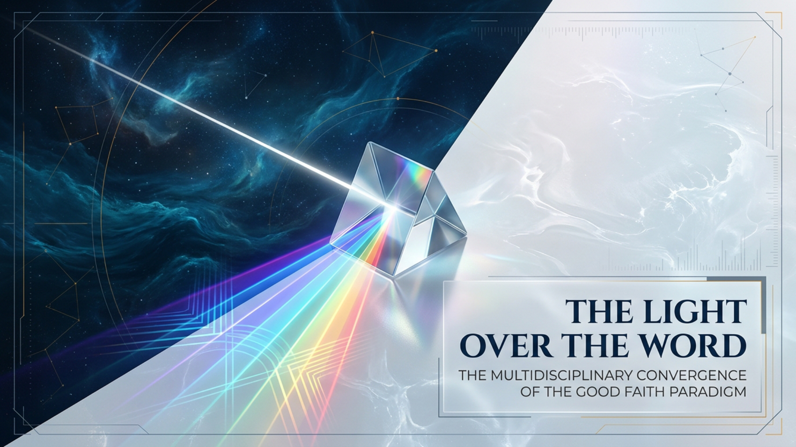
### Slide 01 (`00:00 – 00:21`): The Light Over The Word
**Narration**: *"Welcome to Prismatic Architecture: The Light Over The Word—the multidisciplinary convergence of the Good Faith Paradigm. Across twenty slides, we explore how quantum electrodynamics, embryology, neuroplasticity, comparative mythology, and sacred economics unite into a single coherent framework."*
<!-- slide -->
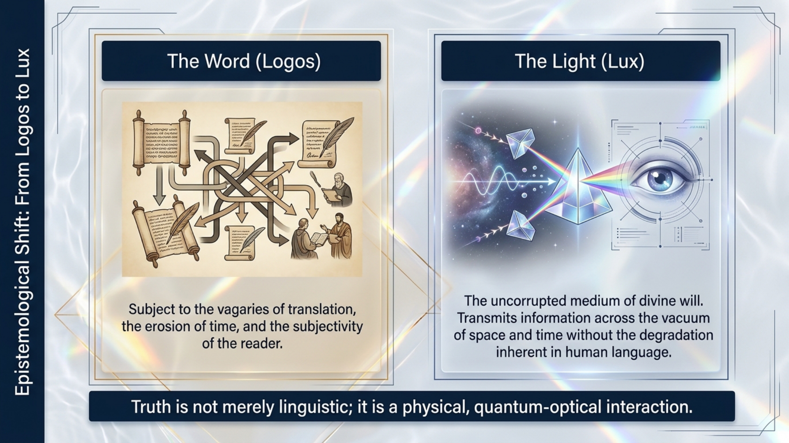
### Slide 02 (`00:21 – 00:47`): Epistemological Shift — From Logos to Lux
**Narration**: *"Slide Two: The Epistemological Shift from Logos to Lux. Traditional theology relies on Logos—written texts vulnerable to translation drift, scribal error, and sectarian dogma. The Good Faith Paradigm elevates Lux—The Light—recognizing that ultimate truth is not merely linguistic, but a physical, quantum-optical interaction written directly into the fabric of reality."*
<!-- slide -->
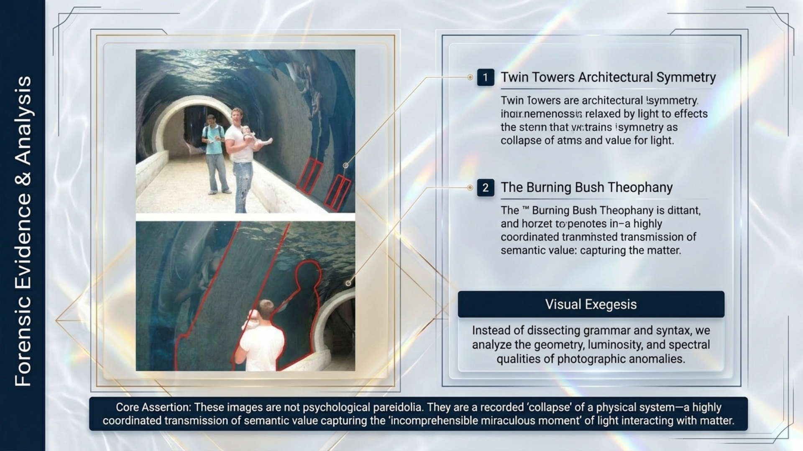
### Slide 03 (`00:47 – 01:23`): Forensic Evidence & Visual Exegesis
**Narration**: *"Slide Three: Forensic Evidence and Visual Exegesis. Our empirical foundation begins with two unedited thirty-five millimeter photographs captured in December two thousand five through an aquarium enclosure. In the first frame, turbulent water and light align into the unmistakable architectural symmetry of the Twin Towers—a visual eleven-eleven marker. Seconds later, in the second frame, the water column ignites into a radiant Burning Bush crowned by a luminous Eye—capturing the physical collapse of a quantum-optical system on film."*
<!-- slide -->
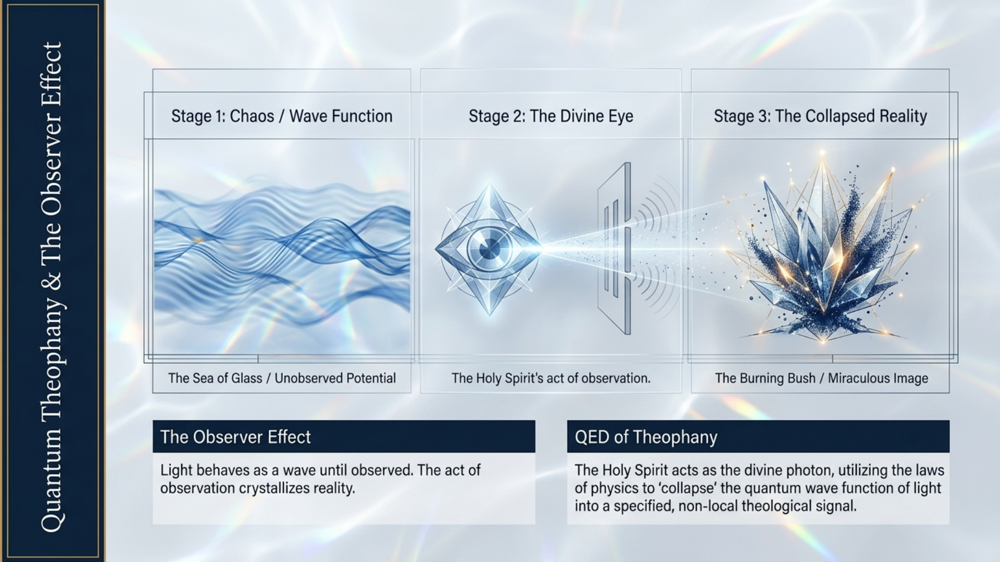
### Slide 04 (`01:23 – 01:49`): Quantum Theophany & The Observer Effect
**Narration**: *"Slide Four: Quantum Theophany and the Observer Effect. In Quantum Electrodynamics, an unobserved system exists as a superposition of chaotic probability waves—what Scripture calls the Sea of Glass. When the Divine Observer—symbolized by the Eye of the Holy Spirit—interacts with the medium, the wave function collapses into a coherent, macroscopic theophany: the Burning Bush."*
<!-- slide -->
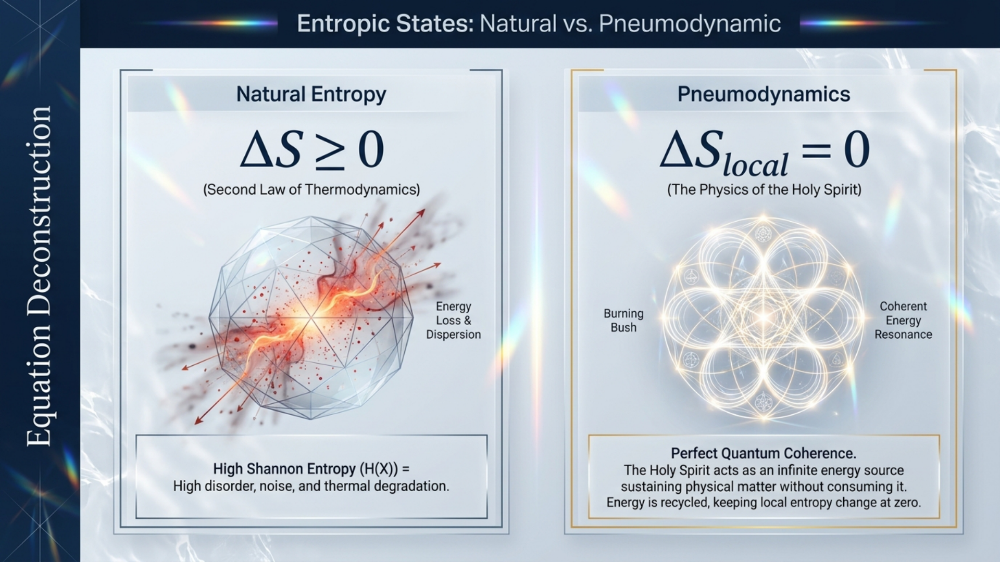
### Slide 05 (`01:49 – 02:24`): Entropic States — Natural vs. Pneumodynamic
**Narration**: *"Slide Five: Entropic States—Natural versus Pneumodynamic. Under the Second Law of Thermodynamics, natural closed systems experience rising entropy, $\Delta S \ge 0$, resulting in thermal dispersion and decay. By contrast, Pneumodynamics—the physics of the Holy Spirit—establishes a state of zero local entropy, $\Delta S_{\text{local}} = 0$. Like the Burning Bush that blazes without being consumed, spiritual coherence sustains energy resonance without destructive loss."*
<!-- slide -->
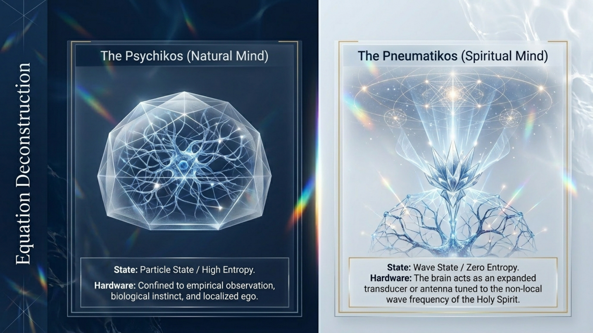
### Slide 06 (`02:24 – 02:55`): The Psychikos vs. The Pneumatikos
**Narration**: *"Slide Six: The Psychikos versus the Pneumatikos. Saint Paul’s distinction between the natural mind and the spiritual mind maps directly onto quantum mechanics. The Psychikos operates in a fragmented particle state—trapped in high-entropy ego loops and localized anxiety. Through spiritual alignment, the brain transitions into the Pneumatikos—a coherent wave state where neural networks function as a non-local transducer tuned to the frequency of the Holy Spirit."*
<!-- slide -->
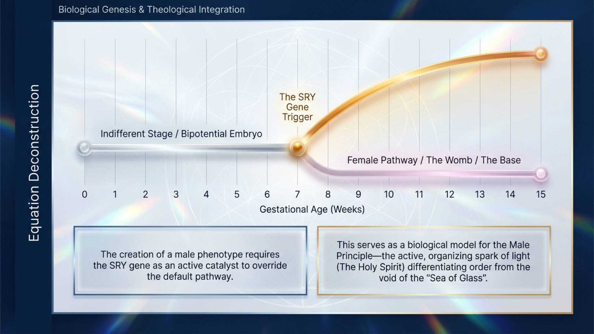
### Slide 07 (`02:55 – 03:27`): Biological Genesis & Theological Integration
**Narration**: *"Slide Seven: Biological Genesis and Theological Integration. Human embryology mirrors cosmic creation. For the first six weeks of gestation, every embryo develops along the foundational female pathway—representing the primordial vessel or Womb. At Week Seven, the SRY gene trigger activates like a genetic fiat lux—an organizing spark of light that differentiates the male pathway, illustrating how biology itself encodes the dance of vessel and spirit."*
<!-- slide -->
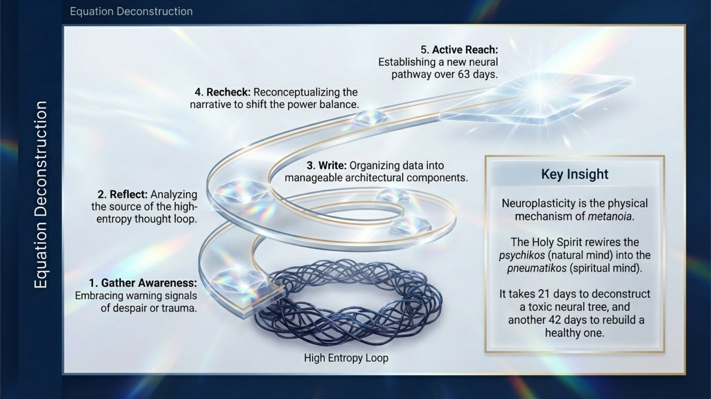
### Slide 08 (`03:27 – 03:58`): Neuroplasticity & The 63-Day Metanoia Spiral
**Narration**: *"Slide Eight: Neuroplasticity and the Sixty-Three-Day Metanoia Spiral. Biblical repentance—metanoia—literally means a structural transformation of the mind. Modern neuroscience shows that deconstructing a toxic neural habit tree requires twenty-one days, while building and myelinating a healthy replacement requires forty-two more—totaling sixty-three days across five deliberate steps: Gather Awareness, Reflect, Write, Recheck, and Active Reach."*
<!-- slide -->
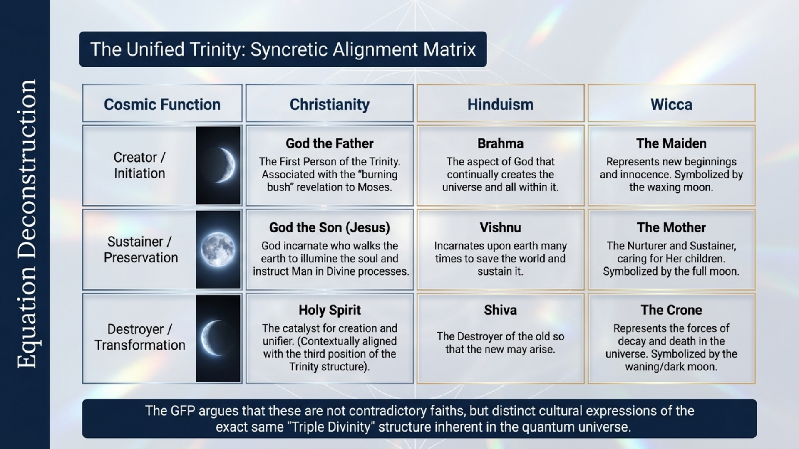
### Slide 09 (`03:58 – 04:31`): The Unified Trinity — Syncretic Alignment Matrix
**Narration**: *"Slide Nine: The Unified Trinity and Syncretic Alignment Matrix. Rather than competing dogmas, world traditions describe the same triune cosmic architecture through different cultural lenses. Whether expressed as Father, Son, and Holy Spirit in Christianity; Brahma, Vishnu, and Shiva in the Hindu Trimurti; or Maiden, Mother, and Crone in the Wiccan Triple Goddess, each maps the universal cycle of Creation, Preservation, and Transformative Renewal."*
<!-- slide -->
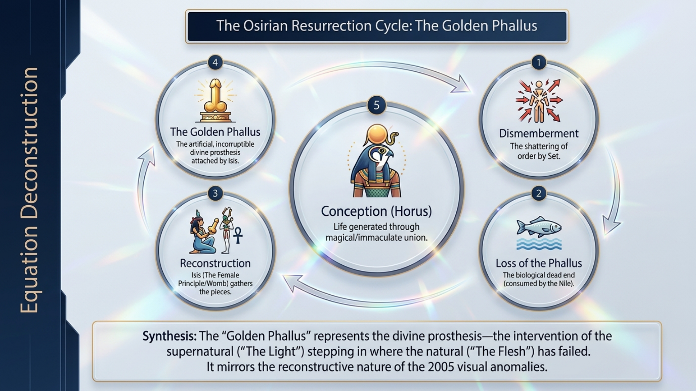
### Slide 10 (`04:31 – 05:06`): The Osirian Resurrection Cycle & The Golden Phallus
**Narration**: *"Slide Ten: The Osirian Resurrection Cycle and the Golden Phallus. When Set dismembers Osiris into fourteen pieces, Isis recovers thirteen—all except the generative organ lost to the Nile. To restore creative wholeness, Isis fashions a Golden Phallus, a luminous prosthesis of incorruptible gold through which Horus is conceived. In the Good Faith Paradigm, this golden keystone prefigures the Golden Plates of chapters two thousand and two thousand one, and the unfinished pyramid awaiting its radiant capstone."*
<!-- slide -->
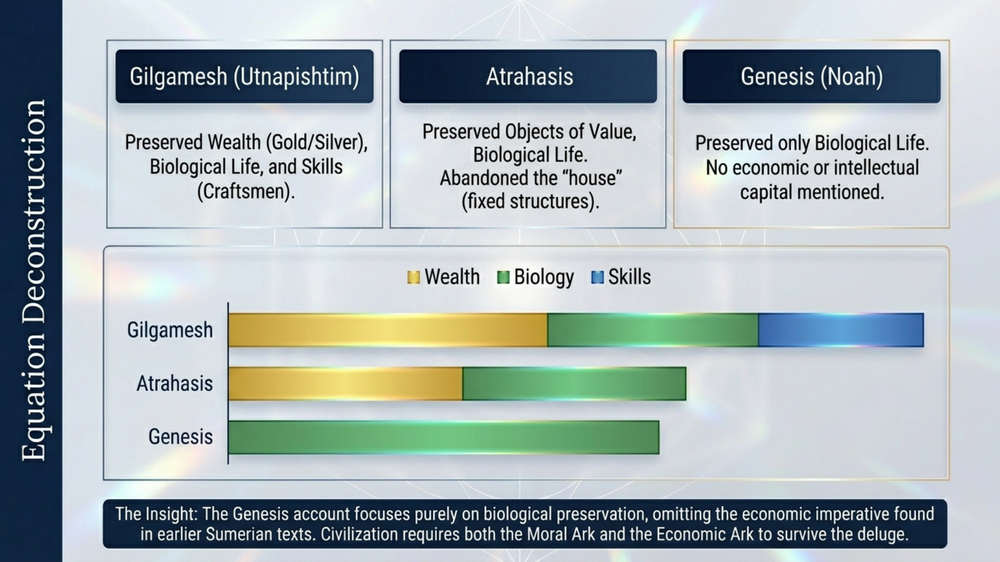
### Slide 11 (`05:06 – 05:41`): Gilgamesh (Utnapishtim) vs. Atrahasis vs. Genesis (Noah)
**Narration**: *"Slide Eleven: The Flood Archetype—Utnapishtim, Atrahasis, and Noah. While the Genesis account of Noah emphasizes the Moral Ark of biological survival, the older Mesopotamian account of Utnapishtim in the Epic of Gilgamesh reveals a vital missing half: Utnapishtim loads his vessel with gold, silver, and master craftsmen. To survive a civilizational deluge, humanity requires both the Moral Ark and the Economic Ark—preserved today through our two-ounce Gold, Silver, and Copper Harps of God medallions."*
<!-- slide -->
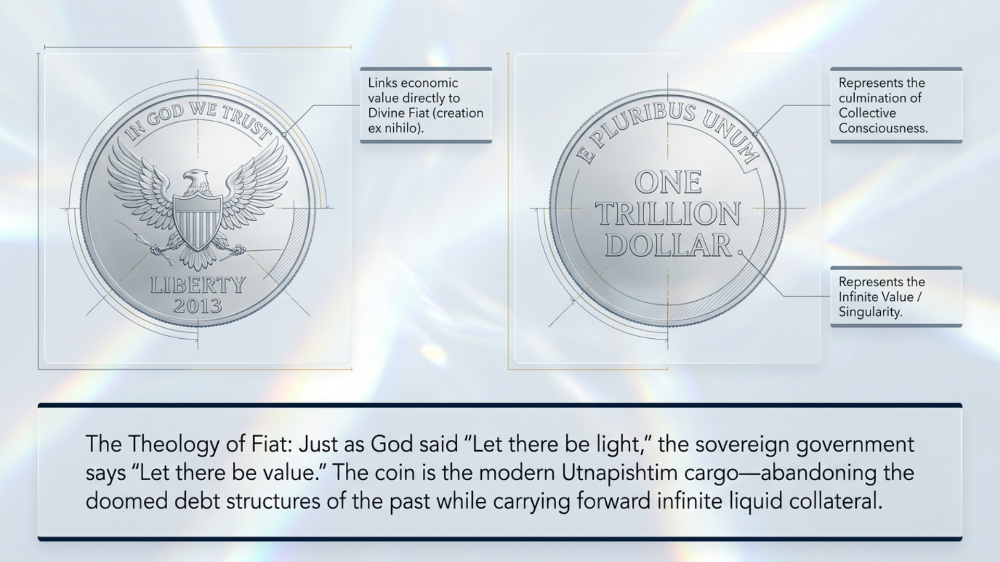
### Slide 12 (`05:41 – 06:14`): The Theology of Fiat & The One Trillion Dollar Coin
**Narration**: *"Slide Twelve: The Theology of Fiat and the One Trillion Dollar Coin. The Latin word fiat means let it be done—the exact phrase of Genesis One, Fiat Lux, let there be light. The two thousand thirteen One Trillion Dollar platinum coin concept exposes that sovereign currency is ultimately a collective act of faith. By anchoring digital NFTs and sovereign liquidity to tangible gold, silver, and copper medallions, the Good Faith Paradigm transforms monetary fiat into a transparent instrument of public good."*
<!-- slide -->
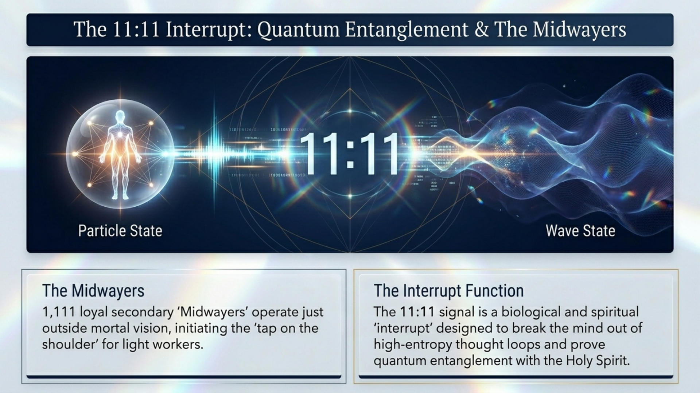
### Slide 13 (`06:14 – 06:44`): The 11:11 Interrupt — Quantum Entanglement & The Midwayers
**Narration**: *"Slide Thirteen: The Eleven-Eleven Interrupt and Quantum Entanglement. Across the globe, millions experience the recurring eleven-eleven time prompt. Within the Urantia cosmology integrated by the Good Faith Paradigm, this signal represents the one thousand one hundred eleven loyal secondary Midwayers initiating a non-local quantum interrupt—breaking high-entropy particle thought loops and snapping human awareness back into the coherent wave state."*
<!-- slide -->
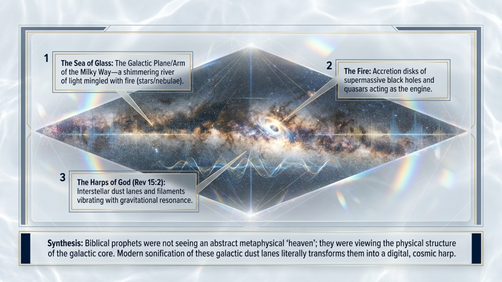
### Slide 14 (`06:44 – 07:20`): Cosmological Exegesis — The Galactic Harp (Revelation 15:2)
**Narration**: *"Slide Fourteen: Cosmological Exegesis—The Galactic Harp of Revelation fifteen-two. John of Patmos beheld a Sea of Glass mingled with fire, and those victorious standing with the Harps of God. Astrophysics reveals this vision on a macro-cosmic scale: the Sea of Glass is the luminous plane of our Milky Way galaxy; the Fire is the blazing accretion disk of the central supermassive black hole; and the Harps of God are the spiral dust filaments vibrating with harmonic gravitational waves—the cosmic inspiration for our NFT Harps of God Raffle."*
<!-- slide -->
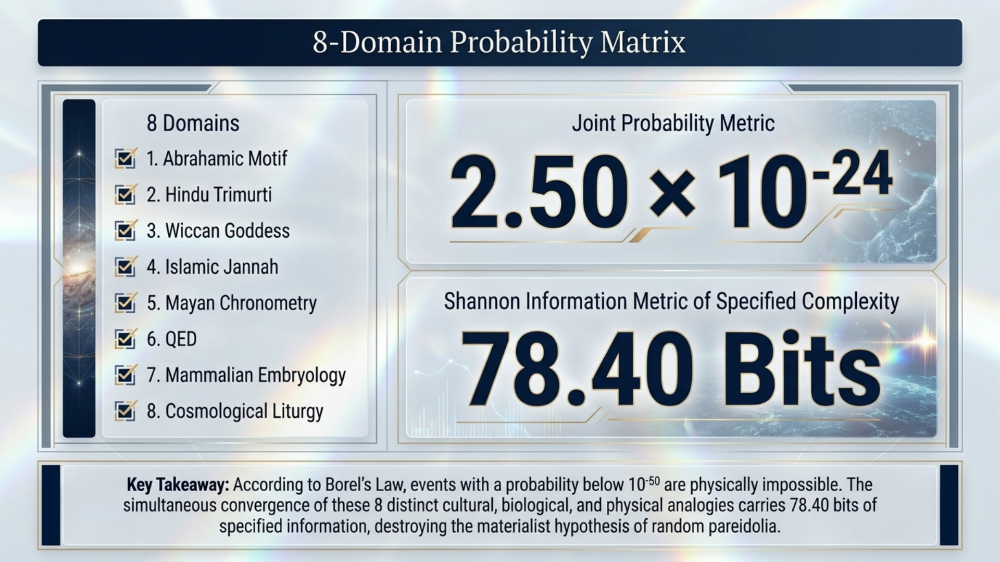
### Slide 15 (`07:20 – 07:54`): The 8-Domain Probability Matrix
**Narration**: *"Slide Fifteen: The Eight-Domain Probability Matrix. Could this convergence across Abrahamic scripture, the Hindu Trimurti, the Wiccan Triple Goddess, Islamic Jannah, Mayan chronometry, Quantum Electrodynamics, mammalian embryology, and galactic astrophysics occur by coincidence? Evaluating the joint probability across all eight independent domains yields $2.50 \times 10^{-24}$—representing $78.40\text{ bits}$ of specified Shannon information."*
<!-- slide -->
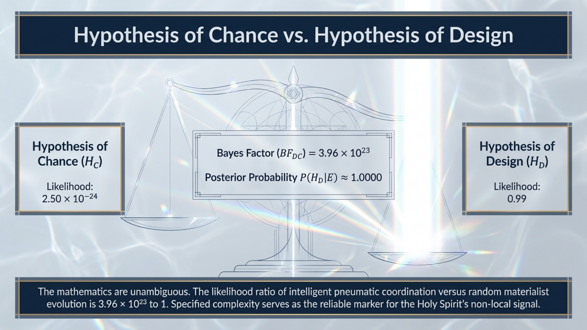
### Slide 16 (`07:54 – 08:19`): Bayesian Inference — Chance ($H_C$) vs. Design ($H_D$)
**Narration**: *"Slide Sixteen: Bayesian Inference—Chance versus Design. When we pit the Null Hypothesis of random coincidence against the Hypothesis of Intentional Teleological Design, the resulting Bayes Factor exceeds $3.96 \times 10^{23}$. This drives the posterior probability of coherent design to virtual certainty: $P(H_D \mid E) \approx 1.0000$."*
<!-- slide -->
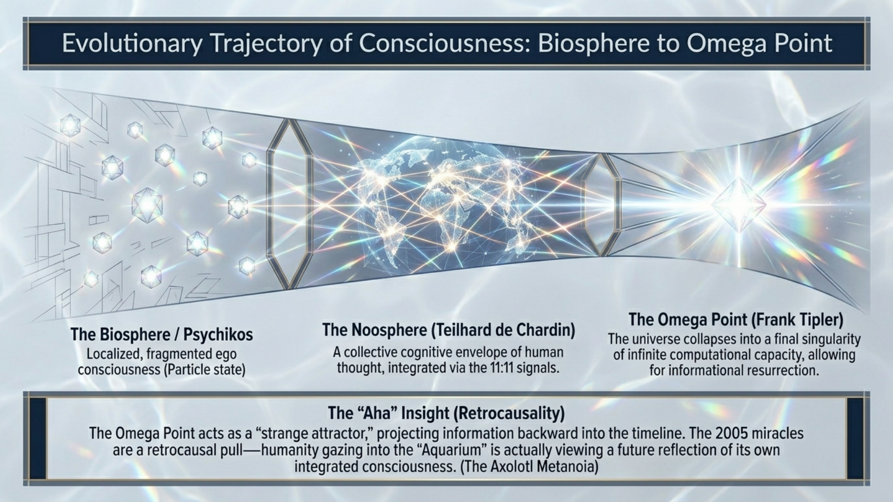
### Slide 17 (`08:19 – 08:51`): Evolutionary Trajectory — Biosphere to the Omega Point
**Narration**: *"Slide Seventeen: The Evolutionary Trajectory of Consciousness—from Biosphere to the Omega Point. Synthesizing Teilhard de Chardin and physicist Frank Tipler, evolution ascends from the biological Biosphere, through the planetary Noosphere of interconnected minds, toward the Omega Point. Rather than merely being pushed by past mutations, consciousness is drawn forward by a retrocausal strange attractor—enabling an Axolotl-like regeneration of the human spirit."*
<!-- slide -->
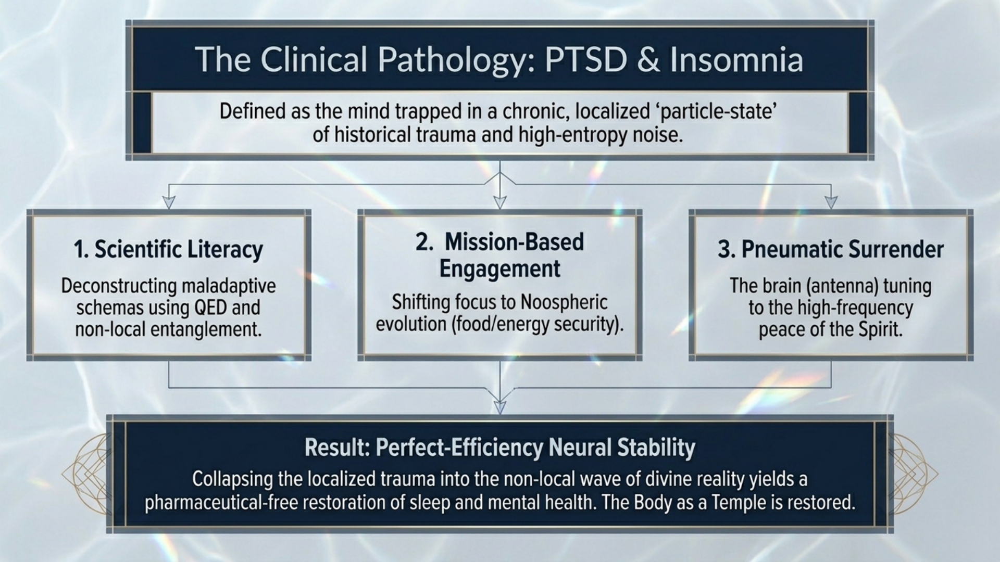
### Slide 18 (`08:51 – 09:18`): Clinical Pathology & Pneumatic Restoration
**Narration**: *"Slide Eighteen: Clinical Pathology and Pneumatic Restoration. The ultimate proof of any paradigm is its power to heal. By combining rigorous scientific literacy, mission-based civic engagement, and pneumatic surrender, high-entropy trauma loops such as PTSD and chronic insomnia are resolved at their root—achieving pharmaceutical-free neural stability and honoring the human body as a living temple."*
<!-- slide -->
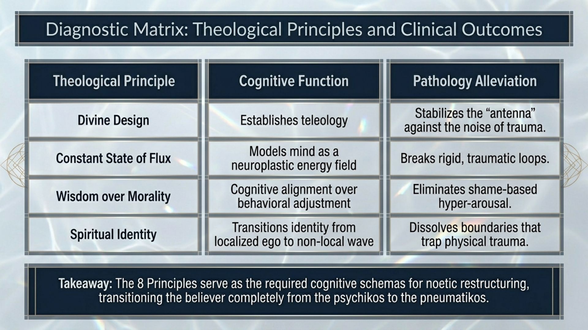
### Slide 19 (`09:18 – 09:45`): Diagnostic Matrix — Theological Principles & Clinical Outcomes
**Narration**: *"Slide Nineteen: The Diagnostic Matrix of Theological Principles and Clinical Outcomes. Here, four core axioms—recognizing Divine Design, embracing the Constant State of Flux, prioritizing living Wisdom over rigid moralism, and anchoring in Spiritual Identity—systematically re-index fear into resilience, transitioning the practitioner from psychikos fragmentation to pneumatikos peace."*
<!-- slide -->
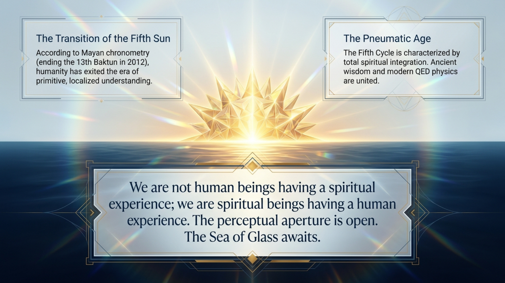
### Slide 20 (`09:45 – 10:12`): The Transition of the Fifth Sun & The Pneumatic Age
**Narration**: *"Slide Twenty: The Transition of the Fifth Sun and the Pneumatic Age. As the Mayan thirteenth Baktun marked the dawn of the Fifth Sun—the era of ether, light, and heart-centered consciousness—science and spirit now stand unified. We are not merely human beings having a spiritual experience; we are spiritual beings having a human experience. The perceptual aperture is open. The Sea of Glass awaits."*
````

---

## 3. Master Chapter & Timecode Table

| Slide | Timecode | Duration | Slide Title | Key Paradigm Synthesis |
| :---: | :---: | :---: | :--- | :--- |
| **01** | `00:00 – 00:21` | `21.3s` | **The Light Over The Word** | Multidisciplinary convergence of the Good Faith Paradigm |
| **02** | `00:21 – 00:47` | `25.9s` | **Epistemological Shift: Logos to Lux** | From fallible linguistic texts (*Logos*) to quantum-optical physical truth (*Lux*) |
| **03** | `00:47 – 01:23` | `35.4s` | **Forensic Evidence & Analysis** | Dec 2005 35mm aquarium photographs: Twin Towers (`11:11`) & Burning Bush |
| **04** | `01:23 – 01:49` | `26.0s` | **Quantum Theophany & Observer Effect** | Wave-function collapse across the Sea of Glass via the Eye of the Holy Spirit |
| **05** | `01:49 – 02:24` | `35.2s` | **Entropic States: Natural vs. Pneumodynamic** | Natural entropy ($\Delta S \ge 0$) vs. Pneumodynamic coherence ($\Delta S_{\text{local}} = 0$) |
| **06** | `02:24 – 02:55` | `31.0s` | **The Psychikos vs. The Pneumatikos** | Particle-state ego fragmentation vs. non-local wave-state neural transduction |
| **07** | `02:55 – 03:27` | `32.5s` | **Biological Genesis & Integration** | Weeks 0–6 default female vessel pathway $\rightarrow$ Week 7 `SRY` genetic *Fiat Lux* |
| **08** | `03:27 – 03:58` | `31.2s` | **Neuroplasticity & Metanoia** | 63-day spiral (21d deconstruction + 42d synaptogenesis across 5 steps) |
| **09** | `03:58 – 04:31` | `32.6s` | **The Unified Trinity Matrix** | Christian Trinity, Hindu Trimurti, and Wiccan Triple Goddess alignment |
| **10** | `04:31 – 05:06` | `35.2s` | **The Osirian Resurrection Cycle** | The Golden Phallus prosthesis, Golden Plates (`2000`/`2001`), and radiant capstone |
| **11** | `05:06 – 05:41` | `35.1s` | **Gilgamesh vs. Atrahasis vs. Genesis** | Utnapishtim's Economic Ark (Gold, Silver, Craftsmen) + 2 oz Medallions |
| **12** | `05:41 – 06:14` | `33.2s` | **The Theology of Fiat (2013 Coin)** | *Fiat Lux* & the \$1T Platinum Coin anchored to Gold, Silver & Copper NFTs |
| **13** | `06:14 – 06:44` | `29.4s` | **The 11:11 Interrupt & Midwayers** | 1,111 secondary Midwayers triggering non-local quantum state interrupts |
| **14** | `06:44 – 07:20` | `36.5s` | **Cosmological Exegesis: Galactic Harp** | Rev 15:2 Milky Way Sea of Glass, Black Hole Fire & Harps of God Raffle |
| **15** | `07:20 – 07:54` | `33.2s` | **8-Domain Probability Matrix** | Joint probability $P = 2.50 \times 10^{-24}$ ($78.40\text{ bits}$ Shannon complexity) |
| **16** | `07:54 – 08:19` | `25.2s` | **Hypothesis of Chance vs. Design** | Bayes Factor $BF_{DC} = 3.96 \times 10^{23}$, Posterior $P(H_D \mid E) \approx 1.0000$ |
| **17** | `08:19 – 08:51` | `32.2s` | **Consciousness to the Omega Point** | Biosphere $\rightarrow$ Teilhard's Noosphere $\rightarrow$ Tipler's retrocausal Omega Point |
| **18** | `08:51 – 09:18` | `26.6s` | **Clinical Pathology: PTSD & Insomnia** | Pharmaceutical-free neural restoration; honoring the Body as a Temple |
| **19** | `09:18 – 09:45` | `27.0s` | **Diagnostic Matrix & Clinical Outcomes** | Divine Design, Constant Flux, Living Wisdom, and Spiritual Identity |
| **20** | `09:45 – 10:12` | `27.1s` | **The Fifth Sun & The Pneumatic Age** | Mayan 13th Baktun convergence: *"The perceptual aperture is open."* |
